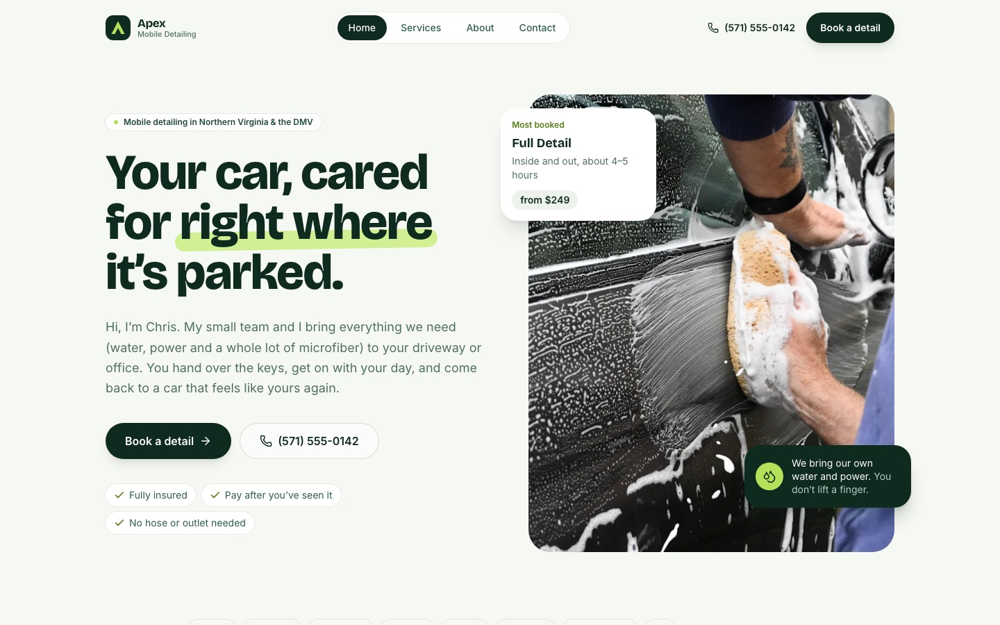
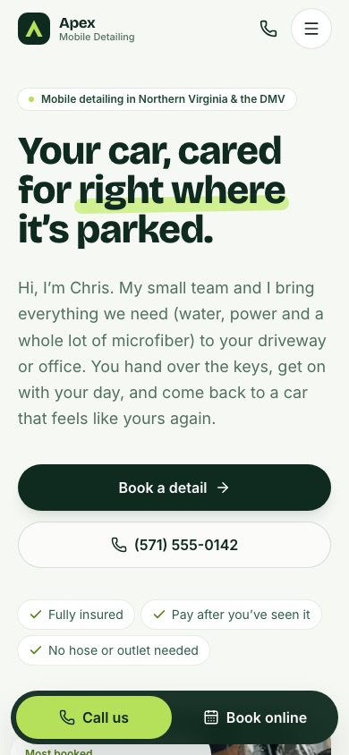
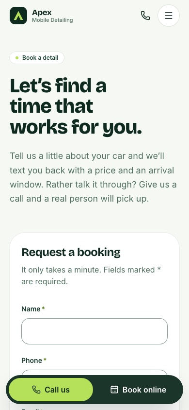
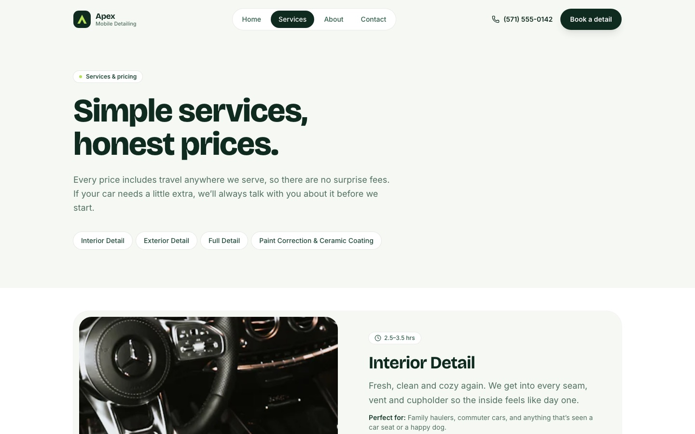

# Apex Mobile Detailing

A marketing site for a mobile car detailing business serving Northern Virginia and the DC area. Built with React, Vite and Tailwind CSS, pre-rendered to static HTML, and set up for Netlify.

> **Concept project.** Apex Mobile Detailing is a fictional business. The reviews, phone number, owner story and pricing are illustrative, and the site says so in its footer.

**Live demo:** [apex-mobile-detailing-example.netlify.app](https://apex-mobile-detailing-example.netlify.app) · **Code:** [github.com/shawnbull26/apex-mobile-detailing](https://github.com/shawnbull26/apex-mobile-detailing) · **Case study:** [docs/CASE_STUDY.md](docs/CASE_STUDY.md)



| Home (mobile) | Booking form (mobile) | Services (desktop) |
| --- | --- | --- |
|  |  |  |

## Highlights

- **Built to get calls and bookings.** Call and book buttons in the hero, the header and every closing section, plus a sticky call bar on phones. Each "Book this service" link opens the form with that service already selected.
- **Pre-rendered pages.** A build step renders every route to its own HTML file, with its own title, description, canonical link and Open Graph tags. React then takes over in the browser (hydration).
- **Accessible.** Semantic landmarks, a skip link, a keyboard-trapped mobile menu, visible focus styles, labelled form fields with inline validation, a keyboard-operable before/after slider, and reduced-motion support.
- **Fast.** Self-hosted variable fonts with preloads, responsive WebP images (480/800/1600w) loaded lazily below the fold, and about 100 KB of compressed JavaScript.
- **Easy to edit.** Business details, services, prices, reviews, images and SEO text each live in one file under `src/data/`.

## Lighthouse

Mobile emulation, measured against the local production build (`npm run preview`):

| Page | Performance | Accessibility | Best practices | SEO |
| --- | --- | --- | --- | --- |
| Home | 88 | 100 | 100 | 100 |
| Services | 95 | 100 | 100 | 100 |
| About | 97 | 100 | 100 | 100 |
| Contact | 98 | 100 | 100 | 100 |

Scores on Netlify should be similar or better because of CDN compression and caching.

## Tech stack

- React 19, React Router 7
- Vite 6, Tailwind CSS 4
- `lucide-react` icons, Fontsource variable fonts (Bricolage Grotesque, Inter)
- Netlify Forms for booking requests

## Getting started

```bash
npm install
npm run dev       # dev server at http://localhost:5173
npm run build     # client build, SSR build, then prerender into dist/
npm run preview   # serve dist/ locally
```

## Project structure

```
src/
  components/
    home/           Hero, ServicesOverview, WhyUs, Process, Testimonials
    layout/         Header, Footer, MobileCallBar, Layout (scroll + reveal)
    ui/             Button, Card, Container, Eyebrow, ImageSlot, Logo, SectionHeading
    BeforeAfter.jsx Drag-to-compare slider
    ContactForm.jsx Netlify-ready booking form
    CtaBand.jsx, PageHeader.jsx
  data/             business.js, services.js, testimonials.js, images.js, seo.js
  hooks/            usePageMeta, useReveal
  pages/            Home, Services, About, Contact, NotFound
  entry-server.jsx  Server render entry used by the prerender step
scripts/prerender.js  Writes per-route HTML, 404.html, sitemap.xml, robots.txt
```

## Deploying to Netlify

1. Push the repo to GitHub and import it in Netlify. `netlify.toml` already sets the build command and publish folder.
2. Set `siteUrl` in `src/data/seo.js` to your Netlify URL, so canonical links, social tags and the sitemap point to the right place.
3. After the first deploy, submit the booking form once. Submissions appear under **Forms → contact** in Netlify.

## Customizing

| What | Where |
| --- | --- |
| Phone, email, hours, service area, owner name, portfolio credit | `src/data/business.js` |
| Services, prices, add-ons | `src/data/services.js` |
| Reviews | `src/data/testimonials.js` |
| Photos | `public/images/` + `src/data/images.js` |
| Page titles and descriptions, site URL | `src/data/seo.js` |
| Colors and fonts | `src/index.css` (`@theme`) |

## Photo credits

Free photos from [Unsplash](https://unsplash.com), used under the Unsplash License:

- Hero: Nik
- Interior: Ján Vlačuha
- Exterior foam: Willian Cittadin
- Black sedan: Samuele Errico Piccarini
- Polishing, dashboard and brush close-ups: Luay Barani
- Wheel cleaning: Zac Nielson

The "before" side of the before/after slider is a simulated, filtered copy of the same photo. The site labels it that way.
